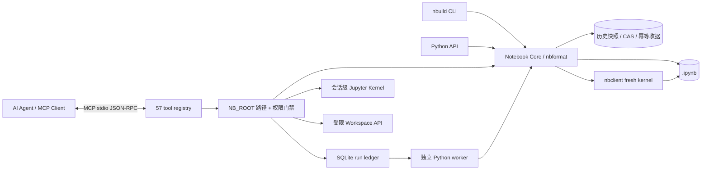

# Notebook Builder v2 — 本地 Agent-Native Jupyter / MCP 工具链

**目标：** 在 `/mnt` 运行环境中构建、编辑、执行、审查和导出标准 `.ipynb`，同时将适合本地运行的 [Nebula-Notebook](https://github.com/1998x-stack/Nebula-Notebook) MCP 核心思想变成可以实际调用的工具，而不是将其完整 Web 服务照搬进容器。

**状态：** v2.1 本地优化版；57 个 MCP 工具，2 类资源入口（Notebook 列表、单 Notebook 模板）；纯 Python CLI/API；SQLite 本地异步作业；本地会话级 Kernel；默认只读和拒绝任意代码执行。当前实例已运行端到端测试，详见 [验证报告](docs/TEST_REPORT.md)。**不是** Nebula 的完整 54-tool / 66-tool API 实现，也不是生产级多租户沙箱。

## 功能总览

| 领域 | 本地实现 | 对应上游 MCP 思路 | 关键限制 |
| --- | --- | --- | --- |
| Notebook 文档 | 创建、列表、导入、导出、标题、软删除、校验 | `notebook_*` | 文件系统替代 FastAPI/SQLite 文档实体 |
| Cell 操作 | 增删改移、Cell ID、CAS、操作幂等 | `cell_*` | 多进程仅对遵守同一文件锁的客户端生效 |
| 历史与冲突 | 不可变旧版本、Fork、恢复、Diff、三方合并 | `notebook_version/fork/merge` | 无 CRDT 实时协作；同一 Cell 冲突需选择 |
| 代码执行 | 全量/分段/单 Cell、临时代码、落盘输出 | `cell_run/run_cells/code_execute` | 本机 Python，不隔离不可信代码 |
| 有状态 Kernel | MCP 进程内启动/关闭、共享变量、元数据探测 | `runtime_*`, `kernel_variables` | 重启 MCP 内存丢失；最多 4 个内核 |
| 可恢复任务状态 | SQLite 任务、幂等提交、等待、取消、失败/中断终态 | `run_submit/status/wait/cancel` | 本地主机子进程，不是云队列或 exactly-once |
| 工作区 | 每 Notebook 的相对路径安全检查、UTF-8 文件 CRUD | `workspace_*` | 不提供 OS 级安全隔离、文件上限 2MB |
| 渲染与审计 | HTML、Markdown、校验、文件 SHA-256 与源码指纹 | 输出/复现能力 | HTML 可能含不可信渲染内容 |
| 科研实验账本 | 评估源码冻结、Trial、真实 Run ID 指标评分、预算、工件存取 | `research_*` | 数据/环境 SHA 是用户断言；并非独立隔离评估 |
| MCP | 57 个 typed tool、JSON Schema、stdio、读写执行门禁 | `mcp/server.py` | 原生适配器实现 MCP 核心子集，不含 prompts/sampling |

### 架构



## v2.1 可靠性与质量门禁更新（2026-11-13）

- **Snapshot / Execute / CAS Commit**：`execute`、`run-cells`、`code` 不再在运行整个 Jupyter Kernel 期间持有 Notebook 文档锁。运行前固定 Notebook 快照与 SHA-256；完成后重新检查版本与内容哈希，发现并发修改会报冲突且不覆盖新文件。注意：已经发生的 Python 外部副作用仍无法回滚；此机制**不是**执行沙箱或 exactly-once。
- **教程 Spec 一致性**：`nbuild tutorial nanogpt --build` 发现已有 `.ipynb` 时比较各 Cell 类型、顺序与源码；不一致直接失败，只有显式 `--force` 才覆盖并记录历史。新建 Spec 文件附 SHA-256 指纹。
- **Notebook Quality**：新增 `nbuild quality` 和只读 MCP `notebook_quality`，核验执行计数、stdout、有效 PNG 头部及图像尺寸、错误输出。质量不合格 CLI 返回 `2`，可用于 CI 门禁；不会仅因存在图片标签便宣称有真实图表。
- **Worker 可观测性**：本地异步作业会保留 `.notebook-runs/logs/<run_id>.log` 诊断记录，文件权限 `0600`，避免因全部丢弃 stderr 难以定位失败。作业仍在当前容器内执行，不提供持久队列或容器隔离。

```bash
nbuild quality tutorials/nanogpt/notebooks/04_training_loop_checkpoint.ipynb
# 质量门禁阈值可配置
nbuild quality tutorials/nanogpt/notebooks/04_training_loop_checkpoint.ipynb --min-prints 2 --min-figures 1
python -m pytest -q tests/test_optimizations.py
```

**关于 Google Drive/Colab：** `.ipynb` 文件嵌入了运行结果与图表，但执行源码依赖本系列的 `nanogpt_edu.py`；单独上传 Notebook 不等于可从任意 Colab 工作目录执行。请将相同的辅助模块放入可访问位置，并先切换 Colab 的工作目录；详见 `tutorials/nanogpt/README.md` 的 Google Drive 说明。不要把静态查看与运行时依赖完整性混为一谈。

## 教学案例：nanoGPT（8 个带 print + figures 的 Notebook）

新增 [nanoGPT 系列教程](tutorials/nanogpt/README.md)；每节都通过本项目 `from_spec → execute → export_html` 完整构建、执行与审查。包含 GPT 张量流、字符分词、因果遮罩、Block 结构、真实 CPU 训练损失、温度/top-k 采样、AdamW/梯度累积和规模/因果不变量测试。共 8 个已执行 Notebook、19 幅 PNG 图和 8 个 HTML 预览；源代码锁定 karpathy/nanoGPT `3adf61e154c3fe3fca428ad6bc3818b27a3b8291`，是教学型改写，非完整 GPT-2 复现。

```bash
nbuild tutorial nanogpt --list
nbuild tutorial nanogpt --build --execute --html
python -m pytest -q tests/test_nanogpt_tutorials.py
```

可直接打开 `tutorials/nanogpt/index.html` 浏览图解课程。所有执行使用本地 CPU 和原创合成语料，不下载权重或外部数据；本机执行**无隔离**，仅运行可信内容。

## 快速使用

已部署到本次环境：

- `/mnt/notebook-builder/`：源码、测试、配置与 Skill
- `/mnt/skills/notebook-builder`：指向该目录的本地 Skill 符号链接
- `/usr/local/bin/nbuild`：CLI 入口
- `/mnt/data/notebooks/`：推荐输出目录，最终用户附件需要从此路径显式链接

```bash
nbuild doctor
nbuild mcp-tools
nbuild create /mnt/data/notebooks/research.ipynb --title "实验设计"
nbuild add /mnt/data/notebooks/research.ipynb --type code --source 'print(6 * 7)' --expected-version 1 --operation-id example-add-001
nbuild inspect /mnt/data/notebooks/research.ipynb
nbuild execute /mnt/data/notebooks/research.ipynb --timeout 120
nbuild html /mnt/data/notebooks/research.ipynb --output /mnt/data/notebooks/research.html
```

**从 JSON Spec 直接创建：**

```bash
nbuild create /mnt/data/notebooks/research.ipynb --spec examples/analysis.json
nbuild validate /mnt/data/notebooks/research.ipynb
nbuild run-cells /mnt/data/notebooks/research.ipynb --start 1 --count 2 --timeout 120
```

**版本与三方合并：**

```bash
nbuild versions /mnt/data/notebooks/research.ipynb
nbuild diff /mnt/data/notebooks/research.ipynb --from-version 1
nbuild fork /mnt/data/notebooks/research.ipynb --version 1 --to /mnt/data/notebooks/research-fork.ipynb
# 从旧版本的未保存 .ipynb 草稿进行合并时：
nbuild merge-preview /mnt/data/notebooks/research.ipynb --base-version 1 --draft draft.ipynb
# 审核冲突后，传入 --choices choices.json 与 --expected-version <最新版本>
```

**异步任务（只运行可信代码）：**

```bash
# 提交某个 Code Cell 执行，可跨多个 CLI 调用查询状态
nbuild run-submit run.ipynb --root /mnt/data/notebooks --cell <CELL_ID> --key trial-001
nbuild run-status <RUN_ID> --root /mnt/data/notebooks
nbuild run-wait <RUN_ID> --root /mnt/data/notebooks --seconds 10
nbuild run-cancel <RUN_ID> --root /mnt/data/notebooks
```

`run-submit` 会在当前**本地容器**内启动子进程；本会话或容器结束时不保证继续执行。执行前先保存 Notebook 版本；任务会检查 `expected_version`，若版本已变化则失败而非覆盖最新文件。已完成/被中断的幂等任务不会自动重新执行。运行时 Python 文件副作用无法回滚。

## MCP stdio 接入

MCP 默认参数：`NB_ROOT=/mnt/data/notebooks`、`NB_MCP_READONLY=1`、`NB_MCP_ALLOW_EXEC=0`。纯 Python 本地协议适配器**无需额外安装 `mcp` SDK**：

```bash
NB_ROOT=/mnt/data/notebooks NB_MCP_READONLY=1 /mnt/notebook-builder/nbuild-mcp
```

标准输入/输出是 MCP JSON-RPC 数据流，因此终端直接运行时通常会一直等待输入，而不是打开交互式 Web UI。只读模式适合先检索 Notebook；获得可信用户授权后，可以为本地专用 Agent 选择 `NB_MCP_READONLY=0`。只有明确需要执行可信代码时才同时设置 `NB_MCP_ALLOW_EXEC=1`。

| 需求 | 示例环境变量 |
| --- | --- |
| 只读 Notebook | `NB_MCP_READONLY=1` |
| 允许创建/编辑 | `NB_MCP_READONLY=0` |
| 允许执行任意本地 Python | `NB_MCP_READONLY=0 NB_MCP_ALLOW_EXEC=1` |
| 选用官方 MCP Python SDK | 安装 `pip install -e '.[official-mcp]'` 并设置 `NB_MCP_TRANSPORT=sdk` |

客户端配置示例在 [`clients/`](clients/)，工具目录见 [`docs/MCP_TOOL_MAP.md`](docs/MCP_TOOL_MAP.md)。原生传输实现 `initialize`、`ping`、`tools/list`、`tools/call`、`resources/list`、`resources/templates/list`、`resources/read`；它没有宣称支持完整官方 SDK 的全部协议扩展，真实客户端版本仍应单独验证。

**安全说明：** MCP 仅建议在专用本机可信 Agent 进程里通过 stdio 使用。不得把此服务或其执行能力直接开放给未知互联网用户，也不要授予它宿主机敏感目录的读写权限。MCP 文件 API 只接受 `NB_ROOT` 内的相对路径，工作区读写有大小限制，但这无法限制 Notebook 内执行的任意 Python 访问宿主机文件/网络。

## 运行模式差异

- `nbuild execute` / `run-cells` / `cell_run`：每次启动全新的 Python Kernel；默认执行之前的代码 Cell 以恢复依赖，然后只保存目标范围输出。
- `code_execute(..., use_live_kernel=false)`：全新 Kernel；`persist=true` 可以把代码和输出追加到 Notebook。
- `runtime_start` + `code_execute(..., use_live_kernel=true)`：在**同一 MCP 进程内**共享 `x`、数组等内存变量；该模式的即时输出不会自动保存为 Notebook Cell。
- `run_submit`：子进程执行单个目标 Cell，SQLite 保存最终状态和 Notebook 输出，客户端断连不自动重复任务。

## 安装与移植

现有环境直接使用即可；移植到新环境：

```bash
python -m pip install -e /path/to/notebook-builder
# 或仅安装基础依赖：
python -m pip install -r requirements.txt
python -m pytest -q tests
```

`pyproject.toml` 提供 `nbuild` / `nbuild-mcp` 命令入口；如果机器没有网络或包缓存，可使用当前带有预装 Jupyter 依赖的环境。**安装代码不等于让 ChatGPT 平台自动发现本地 MCP/Skill**，其他客户端仍需显式配置进程命令。当前会话 `/mnt` 也不保证永久保存；需要时将源码压缩包备份到持久化存储。

## 质量与安全边界

完整工作流建议：`doctor → create/import → inspect → edit (CAS + operation_id) → validate → execute → verify outputs → export → fingerprint`。执行前应审核 Notebook 源码、依赖和数据路径，优先固定随机种子，并在 Markdown Cell 中写明数据出处与假设。

此仓库的安全限制：无 Docker/GPU 调度、无 FastAPI/Web UI、无远程网络服务、无 RBAC/SSO、无跨用户共享、不等同上游科研 Trial/evaluator 不可篡改证明、无 CRDT、无多节点调度。本地 `research_*` 只是有证据链接的实验记录，不保证独立评估环境。原生 JSON-RPC MCP 也没有 prompts、sampling、progress、streamed output 或通知订阅。**切勿将“本地代码执行成功”误称为“沙箱隔离”**。

参考：上游 [`backend/app/cell_ops.py`](https://github.com/1998x-stack/Nebula-Notebook/blob/main/backend/app/cell_ops.py)、[`backend/app/merge.py`](https://github.com/1998x-stack/Nebula-Notebook/blob/main/backend/app/merge.py)、[`backend/app/runtime.py`](https://github.com/1998x-stack/Nebula-Notebook/blob/main/backend/app/runtime.py)、[`mcp/server.py`](https://github.com/1998x-stack/Nebula-Notebook/blob/main/mcp/server.py)。详见 [`UPSTREAM.md`](UPSTREAM.md) 和 [`docs/ARCHITECTURE.md`](docs/ARCHITECTURE.md)。

## 科研实验账本示例

```python
# 评估 Cell 示例，必须确实由成功执行的 evaluator Run 输出指标
import json
accuracy = 0.82  # 示例值，实际应从可信评估过程计算
print('NB_METRIC_V1:' + json.dumps({'name': 'accuracy', 'value': accuracy}))
```

先用 `research_create` 指定冻结的 evaluator Cell、指标与 `dataset_sha256/environment_sha256` 声明，再提交候选 `run_submit` → `research_trial_register`，执行 evaluator `run_submit` → `research_trial_finalize`，通过 `research_get` 查看结果，工件可用 `research_artifact_upload/download` 管理。**该实验账本不会凭空计算准确率，也不保证候选与评估进程的完全隔离。**

## 论文到可执行教程案例：ResNet (arXiv:1512.03385)

新增 [ResNet 原论文完整教学 Notebook](tutorials/resnet/README.md)：包含 ImageNet 18/34/50/101/152 与 CIFAR 6n+2 从头实现、原论文 1×1 Bottleneck stride 语义、Option A/B 快捷连接、Shape/参数/MAC/梯度验证、真实合成图像 24-step 训练、保存与重载、原论文表格拆解、CIFAR/ImageNet 显式 opt-in 真实数据训练入口。使用 `notebook_builder.from_spec → execute → notebook_quality.inspect → export_html`，22 个代码 Cell 与 13 张内嵌图表已执行通过（离线 CPU）。

```bash
nbuild tutorial resnet --list
nbuild tutorial resnet --build --execute --html
pytest -q tests/test_resnet_tutorial.py
```

**范围边界：** 合成数据准确率不能与 ImageNet/CIFAR 正式基准比较；没有运行真实 ImageNet、COCO 检测或分布式复现实验。Tensor / Figure 源码自包含在 `.ipynb` 中。

## Colab-ready ResNet and fresh-session setup

- [ResNet GPU/CPU Colab usage](docs/COLAB_RESNET.md) — self-contained notebook, CUDA auto-detection, optional AMP for toy training, separate paper-vs-demo metrics, opt-in real datasets.
- [Reinstall to `/mnt` in a new ChatGPT session](docs/NEW_SESSION.md) — portable ZIP/Git checkout, conservative offline-compatible installer.
- [Agent maintenance / verification rules](AGENTS.md) — no silent overwrites, no unverified claims, version conflict protection, quality gates and MCP security defaults.

```bash
# From a cloned or extracted source tree
bash scripts/install-to-mnt.sh --quick
python3 nbuild.py tutorial resnet --list
python3 nbuild.py tutorial resnet --build --execute --html --force
```

**Run provenance:** GPU acceleration is used only if `torch.cuda.is_available()`; current CI and local CPU runs do not assert GPU validation. The produced `.ipynb` embeds the full model code. Real ImageNet/CIFAR10 training requires explicit opt-in and data.
