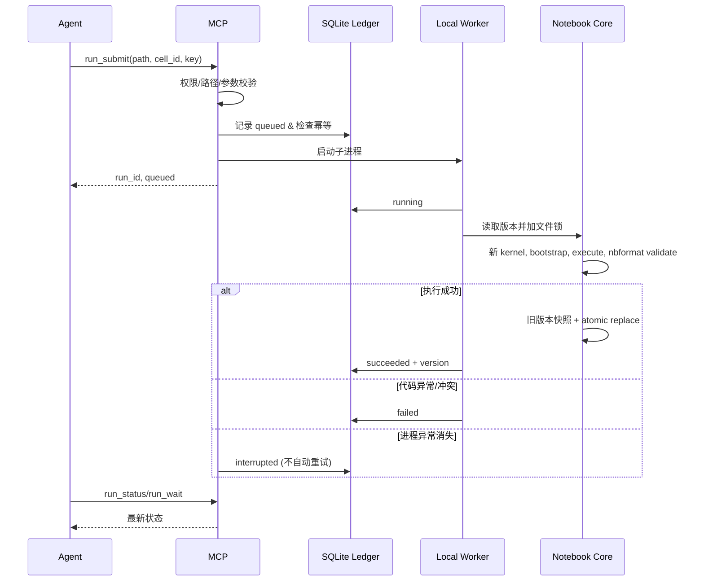

# Notebook Builder v2 架构与安全模型

## 1. 信任边界

1. `nbuild`：由当前机器的命令行用户直接调用，接收本地绝对路径；调用者本身已经可以访问宿主文件系统。
2. `nbuild-mcp`：stdio 适配器只允许 `NB_ROOT` 下面的相对 Notebook 路径，默认只读。所有工具必须经 `mcp_tools.invoke` 校验 Pydantic 参数与写入/执行门禁。
3. `.ipynb`：`nbformat` v4 数据模型，固定最大文档 20MB、单 Cell 源码 2MB；版本号存于 `metadata.notebook_builder.version`，并发修改采用 advisory flock 与 CAS。操作收据嵌入同一 Notebook 原子覆盖中，保留最近 128 项。
4. `.notebook-history/`：提交新版本前保存原有完整 Notebook，命名为 `v<version>-<sha256>.ipynb`；保留历史且不会凭空补造旧版本。
5. `.notebook-runs/runs.sqlite3`：子进程执行任务记录，保存 idempotency_key、expected_version、状态与终态结果。不能与 `.ipynb` 原子提交同一事务，所以任务进程崩溃后的模糊状态是 `interrupted` 而不是自动重试。
6. `.notebook-workspaces/`：独立于 Notebook 文件所在路径的受限小文本文件空间；MCP 文件 API 层面拒绝路径穿越、绝对路径、显式隐藏目录和指向 root 外部的符号链接。并不隔离真正执行中的 Python 进程。

## 2. 执行模型

## 3. 版本三方合并

输入为 `base (不可变版本)`、`mine (用户草稿)`、`latest (当前权威文档)`：

- 某 Cell 只在一方修改，则采用修改方；双方修改结果相同则采用共同结果。
- 同一 Cell 两边不一致、删除与编辑冲突时，明确返回冲突，要求指定 `cell_id: mine|theirs`。
- 两侧均发生冲突性的排序时，返回 `__order__` 冲突；不擅自合并字符级源码。
- 合并写入时再次检查 `expected_version`，防止预览后其他进程覆盖结果。
- 将执行输出和 metadata 视为 Cell 原子部分，而非仅对 source 文本自动合并。

## 4. 限制与防护

**不支持：** 任意网络用户隔离、Docker、GPU 资源管理、Web UI、跨用户 ACL、SSO、CRDT、SSE 事件、多节点分布式锁、跨进程共享的有状态 Kernel、上游科研 Trial evaluator 的完整隔离与不可篡改性、后台云调度或跨主机持久化。

**限制并不等于沙箱：** 任何 `cell_run`、`code_execute`、`run_submit` 都是宿主环境下的任意 Python，能够读取当前 OS 用户可访问的文件并执行网络/子进程操作。使用前必须明确确认代码可信，并建议使用隔离 OS 用户或容器；对于真正不可信代码，当前实现不适合使用。

**文件协同边界：** `fcntl.flock` 只约束使用本工具的写入者；外部编辑器直接覆盖 `.ipynb` 不受 CAS 约束。历史 `.notebook-history` 写入与主文件写入不是一个底层文件系统事务。成功完成主 Notebook 保存之后、SQLite 记录终态之前若工作进程崩溃，系统只能标记不确定状态，绝不盲目重复执行。

**MCP 原生子集：** 实现 initialize、tools/list/call、resources/list/read、ping 等；不实现 MCP 的全部 Transport/Auth/Prompts/Sampling/Elicitation/Subscriptions 扩展。官方 SDK 可选，但本实例未安装且未实机验证该模式。

## 5. 本地 Research Engine（研究结果可追溯，但非独立评估）

1. 使用 `research_create` 冻结 evaluator Cell 的源码 SHA-256、指标名称、方向（maximize/minimize）、预算与调用者声明的数据/环境 SHA。
2. 用 `run_submit` 提交 Candidate Cell，成功后以 `research_trial_register` 关联真实 Candidate Run ID。
3. 再单独执行被冻结的 evaluator Cell。它必须输出一行 `NB_METRIC_V1:{"name":"score","value":0.82}` 形式的数值 JSON（指标名与实验设置一致）。
4. `research_trial_finalize` 检查两个 Run 的实际成功状态、执行版本顺序、冻结 evaluator SHA、保存的 Notebook 版本和指标输出，再记录得分。
5. `research_get` 按指标方向给出最佳 Trial。工件通过 SHA-256 内容寻址，并限制单文件 2MB。

**限制：** 这只是审计友好的单机实验账本。Run ID 和文件哈希为本地证据，不意味着 Notebook 候选代码不能影响评估进程；数据和环境 SHA 是用户自行提供的声明，不能伪装为已验证的文件系统镜像或隔离评估。
